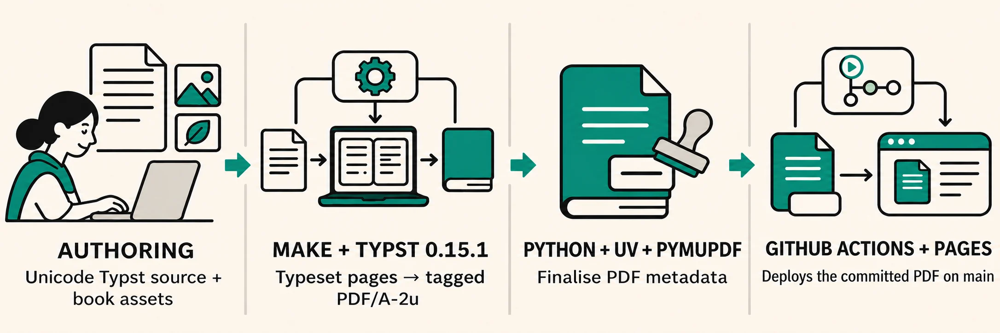

# Science Curiosity / विज्ञान कुतूहल

**विज्ञान कुतूहल (Science Curiosity)** is a Marathi popular-science book
collecting ten articles first published in *Loksatta* in 2011. This edition
redesigns the reading layout and adds captions and image acknowledgements while
preserving the articles and their historical scientific claims.

This repository contains the editable book, its assets and research, and the
finished [PDF](science-curiosity.pdf). The website repository distributes the
PDF for readers; it does not participate in authoring or typesetting the book.



## Technology and architecture

- **Typst 0.15.1** typesets the Unicode `.typ` manuscript and produces tagged
  PDF/A-2u. The pinned version keeps builds consistent.
- **Tiro Devanagari Marathi** and **Mukta** provide the included fonts. Typst's
  bundled fallback fonts cover remaining characters.
- **SVG and raster images** supply the cover and chapter illustrations.
- **Make** provides the build and maintenance commands. **Poppler** renders and
  inspects PDFs; **Python 3.15+**, **uv** and **PyMuPDF** finalise PDF metadata
  and support integrity and recovery tools.
- **rumdl**, **typos** and **lychee** check Markdown, spelling and links.

The source is organised around the book: `chapters/` holds the canonical Marathi
text; `book.typ` defines the cover, front matter and chapter order; `layout.typ`
sets typography and page design. `figures/`, `figures.json` and `credits.typ`
hold illustrations and their acknowledgements, while `fonts/` contains the
licensed font files. The tools in `tools/` check the manuscript and PDF, recover
text from the original source, and finalise the built PDF. Research and source
records live in `provenance/`.

### Build pipeline

1. **Authoring:** the author edits the Unicode Typst manuscript and book assets.
2. **Typesetting:** `make build` checks the pinned Typst version, then Typst
   reads `book.typ`, `layout.typ`, the chapter text, fonts and illustrations to
   produce the tagged PDF/A-2u book.
3. **Finalisation:** a local Python tool using PyMuPDF writes the PDF's viewer
   metadata. `make check` rebuilds the PDF and verifies the text and document
   structure.
4. **Distribution:** `make export-website` copies the finished PDF to the
   website checkout. The website handles presentation and deployment.

## Build locally

Install Typst 0.15.1, Poppler, uv, rumdl, typos and lychee. On macOS, install
the supporting tools with:

```sh
brew install poppler uv rumdl typos-cli lychee
```

Build the PDF from the repository root:

```sh
make build
```

Typst uses the included fonts and images. On the first build, `uv` may download
Python and PyMuPDF if they are not already cached. Run `make help` for the
available commands. Before committing, run `make check lint link-check`; after
typesetting or layout changes, inspect the rendered pages with `make render`.

The public reading copy is available on
[Indrajeet Patil's writing page](https://www.indrapatil.com/writing/).

## Further reading

- [Build pipeline](docs/build-pipeline.md): how Typst typesets the book and
  how the PDF is finalised and distributed.
- [Layout](docs/layout.md): the book's page and typography decisions.
- [Text preservation](docs/text-preservation.md): manuscript recovery and
  comparison with the original source.
- [Illustration sources](docs/illustration-sources.md): image attribution and
  verification status.
